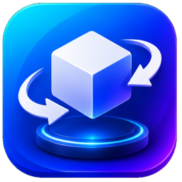

# 3D Viewer

**A fast, fully offline 3D model viewer for Windows and Linux.**
Open a 3D file the way you open a JPG: double-click, drag and drop, or "Open with".

Developed by **Azizul Haque Shaon**

## ⬇️ Download

Get the latest version from the **[Releases page](https://github.com/shaonfl3d/Offline-3D-Viewer/releases/latest)**.

| System | File | How to use |
|---|---|---|
| Windows 10 / 11 (64-bit) | `3DViewer_Setup_x.y.z.exe` | Installer: Start menu entry, desktop shortcut, "Open with" for 3D files |
| Windows 10 / 11 (64-bit) | `3DViewer_portable_x.y.z_windows.zip` | Unzip and run `viewer3d.exe`, nothing to install |
| Linux (64-bit) | `3DViewer_x.y.z_linux_x86_64.tar.gz` | Unpack, then run `./install.sh` (or just `./viewer3d`) |

The app is a single file with everything built in: no internet, no extra runtimes, no account.
It needs a graphics card with OpenGL 3.3, which any PC or laptop from the last ~12 years has.

> Windows may show "Windows protected your PC" the first time, because the app is not code-signed.
> Click **More info → Run anyway**.

## 📂 Supported formats

| Kind | Formats |
|---|---|
| Mesh | `STL` `OBJ` `PLY` `OFF` `GLTF` `GLB` `3MF` `AMF` `DAE` `WRL` `3DS` `BIM` `FBX` |
| CAD | `STEP` / `STP` `IGES` / `IGS` `BREP` / `BRP` `FCSTD` (FreeCAD) |

`IFC` and `3DM` are planned.

## 🌟 Features

* **🎨 Modern interface:** drag-and-drop home screen, Dark and Light themes, Close model to go back home.
* **⚙️ CAD support:** STEP, IGES, BREP and FreeCAD files open directly. A STEP assembly opens with one part per solid.
  Choose the detail level (Draft / Normal / Fine) from the toolbar.
* **🎭 Shaders:**
  * **Standard & Clay:** check raw geometry, form and sculpting detail.
  * **Toon:** cel-shaded look for stylised previews.
  * **Matcap:** 6 built-in matcaps (Clay, Chrome, Gold, Red ceramic, Jade, Pearl), or load your own image.
  * **Normals** and **Unlit:** inspect surface orientation and flat colour.
  * **Solid, Solid + edges and Wireframe** views to check topology and density.
* **💡 Lighting:** direction, height, intensity, ambient and colour, with "Light follows camera".
  Hold `Shift + left-drag` in the view to rotate the light around the model.
* **🌳 Mesh list:** show, hide and select each part of a model or assembly.
* **📊 Model details:** vertices, triangles, size X / Y / Z, volume, surface area, file size, load time and materials,
  for the whole model or for the selected part.
* **🖼️ Presentation:** custom background colour and one-click **Save image** (PNG).
* **🔄 Z-up toggle** for models exported from Z-up software.

## 🛠️ Controls

| Action | Input |
|---|---|
| Orbit | Left-drag |
| Rotate light | Shift + left-drag |
| Pan | Right-drag or middle-drag |
| Zoom | Mouse wheel |
| Fit to view | `F` or double-click |
| Solid / edges / wireframe | `W` |
| Open file | `Ctrl + O` |
| Close model | `Esc` or `Ctrl + W` |

## 🧑‍💻 Build from source

You need [Rust](https://rustup.rs) and, for CAD support, [CMake](https://cmake.org).

**Windows** (also needs Visual Studio Build Tools with "Desktop development with C++"):

    cargo build --release                  # mesh formats only, quick
    cargo build --release --features cad   # adds STEP / IGES / BREP / FCStd

The app is `target\release\viewer3d.exe`. The first CAD build compiles OpenCASCADE into
`target\OCCT`, which takes 30 to 90 minutes; later builds reuse it (`cargo clean` deletes it).
To make the installer, open `packaging\windows\installer.iss` in [Inno Setup](https://jrsoftware.org/isinfo.php) and press F9.

**Linux** (Debian / Ubuntu):

    sudo apt install cmake g++
    cargo build --release --features cad           # OpenCASCADE built from source
    cargo build --release --features cad-system    # or use the distro's OpenCASCADE 7.6+
    packaging/linux/make-package.sh target/release/viewer3d 3DViewer_linux_x86_64

**Tests:** `cargo test --features cad` reads the sample STEP / IGES / BREP files in `cad-sys/tests/data`.

### Releases

`.github/workflows/release.yml` builds the Windows installer, the portable zip and the Linux
package on GitHub's servers. Push a tag such as `v1.0.1` and the files appear in a draft release.

## 📄 Licences

3D Viewer's own code is licensed under the [MIT License](LICENSE).

The CAD support uses [Open CASCADE Technology](https://dev.opencascade.org) 7.8.1, licensed under the
GNU LGPL 2.1 with an additional exception (<https://dev.opencascade.org/resources/licensing>).
It is built from its unmodified source (the `occt-sys` crate) and linked into the app; this repository
contains everything needed to rebuild and relink it. The small C++ bridge to it lives in `cad-sys/`.
